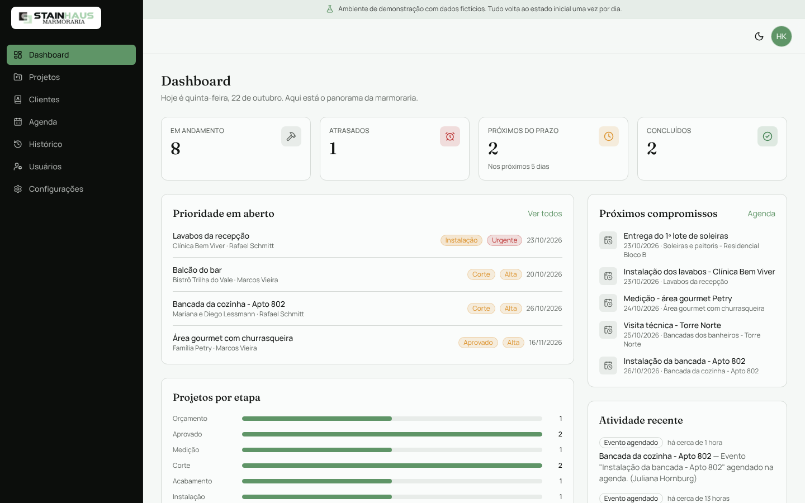
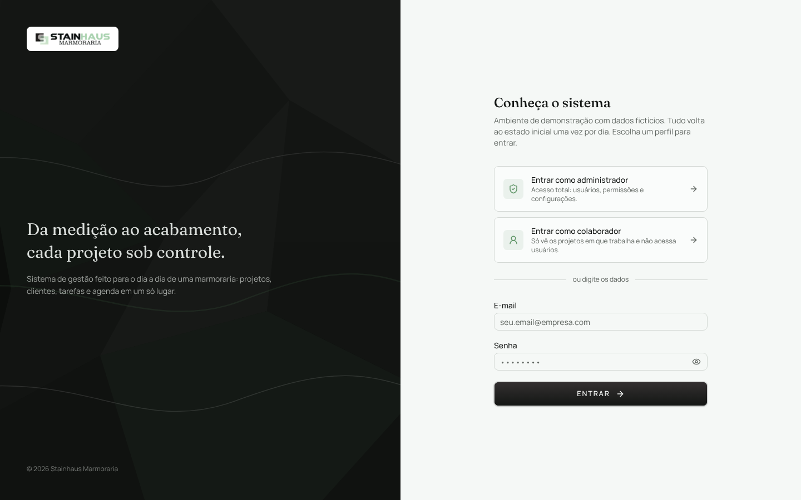
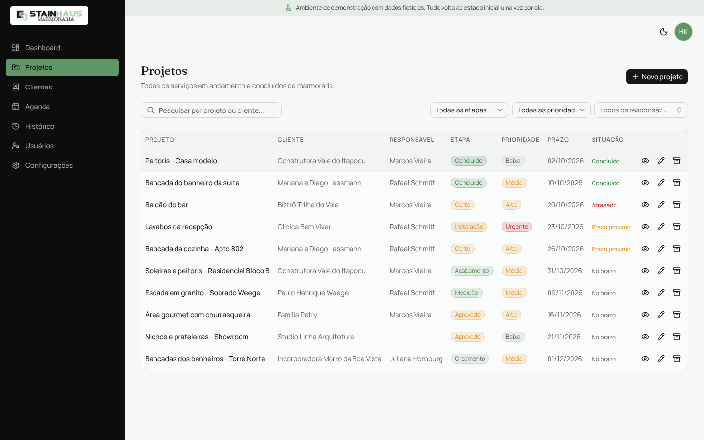
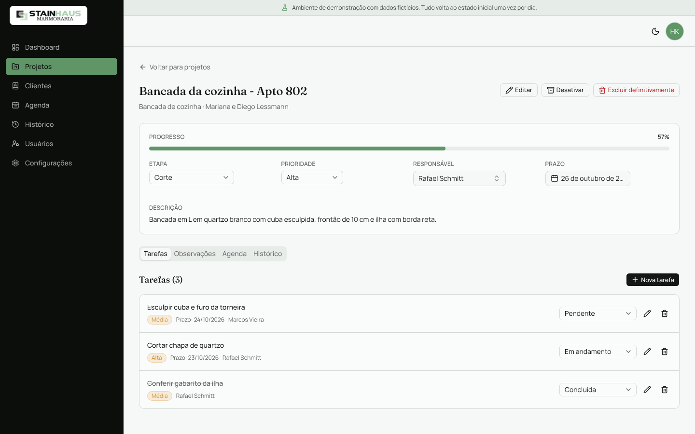
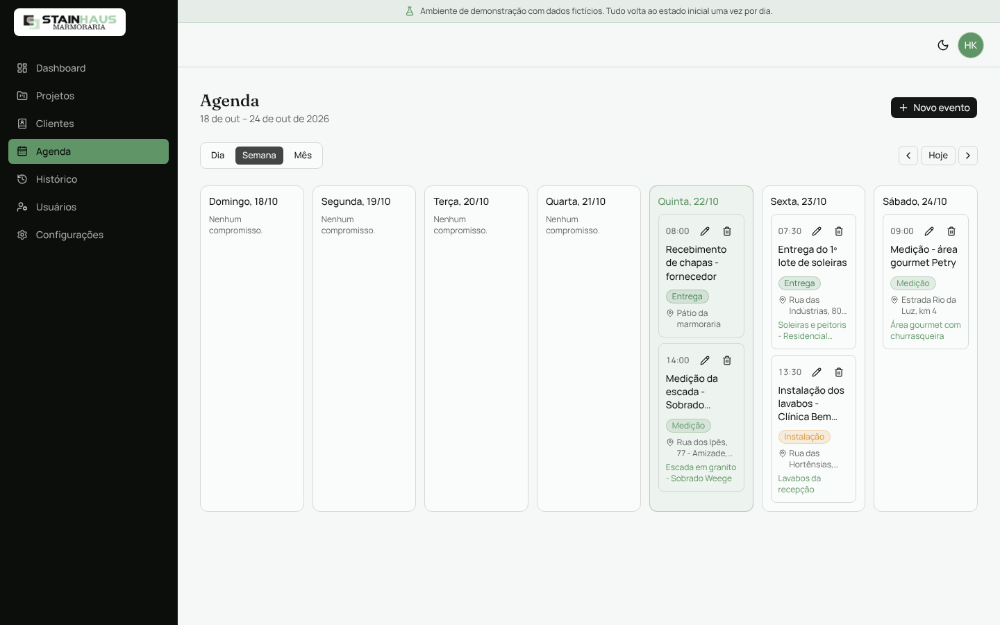
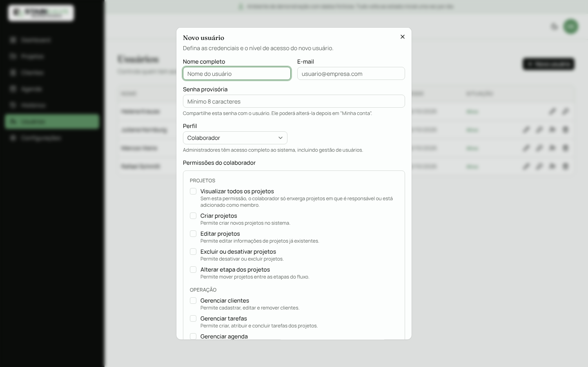
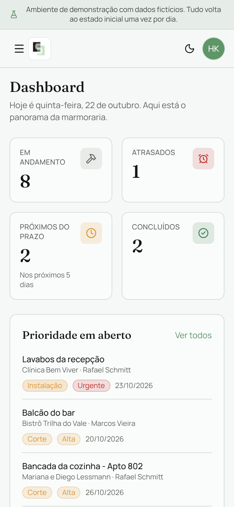

# Stainhaus · Sistema de gestão para marmoraria

Sistema interno feito sob encomenda para a **Stainhaus Marmoraria**, de
Jaraguá do Sul (SC). Ele organiza o caminho de cada peça de pedra, do
orçamento à instalação: clientes, projetos, etapas de produção, tarefas,
agenda de medições e entregas, equipe com permissões e o histórico de tudo o
que aconteceu em cada obra.

O código está público com autorização da Stainhaus. Os dados das capturas e
do modo demonstração são fictícios.



## A Stainhaus

A Stainhaus fornece mármore e granito, nacional e importado, para obras,
indústrias e residências em Jaraguá do Sul e região, com mais de 30 anos de
mercado.

- Site: [stainhaus.com.br](https://www.stainhaus.com.br)
- Instagram: [@stainhausmarmoraria](https://www.instagram.com/stainhausmarmoraria/)
- WhatsApp: [(47) 3370-0180](https://wa.me/554733700180)

## Testar

O sistema tem um **modo demonstração** pensado para quem quer conhecê-lo sem
instalar nada de verdade:

- a tela de login mostra duas contas prontas, uma de administrador e uma de
  colaborador, e entra com um clique;
- o banco vem preenchido com uma marmoraria fictícia: 8 clientes, 11
  projetos espalhados por todas as etapas, tarefas, observações, histórico e
  uma agenda com compromissos na semana atual;
- um aviso fixo lembra que os dados são fictícios, e uma rotina diária
  devolve tudo ao estado inicial;
- as contas de demonstração não podem ter a senha trocada nem ser
  desativadas ou excluídas.

| Perfil | E-mail | Senha | O que dá para ver |
| --- | --- | --- | --- |
| Administrador | `admin@example.com` | `demo-admin` | Tudo, incluindo usuários, permissões e configurações |
| Colaborador | `colaborador@example.com` | `demo-colaborador` | Só os projetos em que trabalha. Sem acesso a usuários e configurações |

Para rodar a demonstração na sua máquina (precisa de Node.js 20+ e um
PostgreSQL vazio):

```bash
git clone https://github.com/saymonthedev/agenda-marmoraria.git
cd agenda-marmoraria
npm install
cp .env.example .env        # preencha DATABASE_URL, DIRECT_URL e AUTH_SECRET
                            # e troque DEMO_MODE para "true"
npx prisma migrate deploy
npm run db:seed:demo        # apaga o banco e cria o cenário fictício
npm run dev                 # http://localhost:3000
```

Roteiro sugerido:

1. Entre como **administrador** e veja o dashboard: atrasados, prazos
   próximos, prioridades e a agenda da semana.
2. Abra **Bancada da cozinha - Apto 802**, mude a etapa de "Corte" para
   "Acabamento" e conclua uma tarefa. As duas ações aparecem na aba
   **Histórico**.
3. Na **Agenda**, troque entre dia, semana e mês e crie um compromisso
   ligado a um projeto.
4. Em **Usuários**, veja como as permissões de um colaborador são
   escolhidas uma a uma.
5. Saia e entre como **colaborador**: a lista de projetos encolhe para os
   dele e os menus de administração somem. Tentar abrir `/usuarios` pela URL
   devolve para o dashboard.

## Telas

| | |
| --- | --- |
|  |  |
| **Login.** No modo demonstração, entra com um clique. | **Projetos.** Busca, filtros por etapa, prioridade e responsável, e situação do prazo. |
|  |  |
| **Projeto.** Etapa, prioridade, responsável e prazo editáveis na própria tela, com tarefas, observações, agenda e histórico. | **Agenda.** Medições, instalações, visitas e entregas em dia, semana ou mês. |
|  |  |
| **Usuários.** Perfil de administrador ou colaborador, com permissões escolhidas uma a uma. | **Celular.** Todas as telas funcionam no celular, com o menu lateral virando gaveta. |

O passo a passo de cada tela e o fluxo de trabalho recomendado estão no
[manual de uso](docs/MANUAL.md).

## O que o sistema faz

- **Projetos** com tipo de serviço (bancada, banheiro, lavabo, escada,
  soleira, área gourmet e outros), cliente, responsável, prioridade, prazo e
  etapa. O fluxo segue a produção real: orçamento, aprovado, medição, corte,
  acabamento, instalação e concluído.
- **Tarefas, observações e histórico** dentro de cada projeto. Toda mudança
  de etapa, prioridade, responsável ou prazo fica registrada com autor e data.
- **Agenda** de medições, instalações, visitas e entregas, ligada ou não a
  um projeto.
- **Clientes** com histórico de projetos. Um cliente com projetos não pode
  ser excluído por engano.
- **Dashboard** com projetos em andamento, atrasados, com prazo próximo
  (número de dias configurável) e concluídos, prioridades em aberto, próximos
  compromissos e atividade recente.
- **Usuários e permissões:** administradores têm acesso total. Colaboradores
  recebem permissões específicas (ver todos os projetos, criar, editar,
  excluir, mudar etapa, gerenciar clientes, tarefas, agenda, histórico e
  configurações).
- **Tema claro e escuro**, horário fixo de Brasília no servidor e interface
  inteira em português.

## Segurança

O sistema guarda dados reais de clientes da marmoraria, então a proteção
foi pensada para um uso interno de verdade:

- **Sem cadastro público.** Só um administrador cria contas.
- **Senhas com hash bcrypt**, com mínimo de 8 caracteres.
- **Nenhuma instalação nasce com senha conhecida.** O seed lê a senha do
  primeiro administrador de `SEED_ADMIN_PASSWORD` ou gera uma aleatória e a
  mostra uma única vez.
- **Autorização no servidor.** Toda ação confere perfil e permissão antes de
  executar, e o acesso a um projeto é sempre consultado no banco, nunca
  confiado ao navegador. Trocar o ID na requisição não abre o projeto de
  outra pessoa.
- **Sessão revalidada a cada 5 minutos.** Conta desativada ou excluída cai
  sozinha, e permissões novas valem sem precisar sair e entrar.
- **Proteção contra força bruta.** Depois de 5 erros para o mesmo e-mail (ou
  20 do mesmo IP) em 15 minutos, o login fica bloqueado temporariamente. O
  registro fica no banco, porque em funções serverless um contador em
  memória não funcionaria.
- **Cabeçalhos HTTP de segurança:** `X-Frame-Options`, CSP com
  `frame-ancestors 'none'`, `X-Content-Type-Options`, `Referrer-Policy`,
  `Permissions-Policy` e HSTS.
- **Rota de manutenção fechada por padrão.** Sem `CRON_SECRET` configurado,
  ela responde 401 para todo mundo.

## Tecnologias

- [Next.js 16](https://nextjs.org/) com App Router e Server Actions
- React 19 e TypeScript
- [Tailwind CSS 4](https://tailwindcss.com/) e componentes
  [shadcn/ui](https://ui.shadcn.com/) sobre [Radix UI](https://www.radix-ui.com/)
- PostgreSQL com [Prisma](https://www.prisma.io/)
- [Auth.js](https://authjs.dev/) (NextAuth v5) com login por e-mail e senha
- [Zod](https://zod.dev/) e React Hook Form na validação
- Publicado na [Vercel](https://vercel.com/) (região São Paulo) com banco
  PostgreSQL gerenciado

```
prisma/
  schema.prisma         modelo de dados
  seed.ts               primeiro administrador (senha do ambiente ou aleatória)
  seed-demo.ts          cenário fictício do modo demonstração
src/
  app/
    login/              tela de login (única página pública)
    (app)/              área autenticada: dashboard, projetos, clientes,
                        agenda, histórico, usuários, conta, configurações
    api/cron/keep-alive rotina diária de manutenção
  components/           interface por domínio (projects, calendar, users...)
  lib/                  autenticação, autorização, permissões, validações,
                        modo demonstração
  server/
    actions/            Server Actions (criar, editar, excluir)
    queries/            consultas ao banco usadas pelas páginas
    demo/               dados fictícios da demonstração
  proxy.ts              proteção de rotas
```

## Instalação

Requisitos: Node.js 20 ou superior e um PostgreSQL, local ou gerenciado
(Neon, Supabase, Railway ou Vercel Postgres).

```bash
npm install
cp .env.example .env              # veja "Variáveis de ambiente"
npx prisma migrate deploy         # cria as tabelas
npx prisma db seed                # cria o primeiro administrador
npm run dev                       # http://localhost:3000
```

O seed cria o administrador com o e-mail de `SEED_ADMIN_EMAIL` e a senha de
`SEED_ADMIN_PASSWORD`. Sem senha definida, ele gera uma aleatória e mostra no
terminal uma única vez. Se o administrador já existe, o seed não mexe nele. A
partir dessa conta, cadastre a equipe em **Usuários**.

Para produção: `npm run build` e `npm run start`.

### Variáveis de ambiente

| Variável | Obrigatória | Descrição |
| --- | --- | --- |
| `DATABASE_URL` | Sim | Connection string do PostgreSQL usada pela aplicação. Em provedores com pooler, use a URL "pooled". |
| `DIRECT_URL` | Sim | Connection string direta, usada só pelas migrations. Sem pooler, pode ser igual à `DATABASE_URL`. |
| `AUTH_SECRET` | Sim | Chave que assina as sessões. Gere com `npx auth secret` ou `openssl rand -base64 32`. |
| `AUTH_URL` | Em produção | URL pública da aplicação. |
| `CRON_SECRET` | Recomendada | Protege a rotina diária de manutenção. |
| `SEED_ADMIN_EMAIL` | Não | E-mail do primeiro administrador. Padrão: `admin@admin.com`. |
| `SEED_ADMIN_PASSWORD` | Não | Senha do primeiro administrador (mínimo 8 caracteres). Vazia, o seed gera uma. |
| `DEMO_MODE` | Não | `true` liga o modo demonstração. Nunca use na instalação real. |

O `.env` real fica fora do Git (ver `.gitignore` e `.vercelignore`).

### Rotina diária e banco serverless

O `vercel.json` agenda um Cron Job diário para `/api/cron/keep-alive`. A
rotina mantém acordado o banco serverless (Neon e similares suspendem o
banco quando fica parado) e apaga registros de login com mais de 24 horas. No
modo demonstração, ela também devolve os dados ao cenário inicial. A Vercel
envia o `CRON_SECRET` sozinha no cabeçalho de autorização. No plano Hobby,
crons rodam no máximo uma vez por dia.

### Deploy na Vercel

1. Importe o repositório na Vercel.
2. Cadastre as variáveis de ambiente. Se o banco estiver ligado ao projeto
   pela aba **Storage**, a Vercel preenche as de conexão sozinha.
3. Rode as migrations e o seed contra o banco de produção uma única vez:
   ```bash
   DATABASE_URL="<produção>" DIRECT_URL="<produção>" npx prisma migrate deploy
   DATABASE_URL="<produção>" SEED_ADMIN_PASSWORD="<senha forte>" npx prisma db seed
   ```
4. Faça o deploy. Cada push no branch principal publica uma nova versão.

### Publicar uma demonstração

Use um projeto da Vercel e um banco **separados** da instalação real, com
`DEMO_MODE=true`. Depois das migrations, rode `npm run db:seed:demo` contra
esse banco. O script se recusa a rodar sem `DEMO_MODE=true`, porque apaga
todos os dados antes de criar o cenário.

## Créditos

Desenvolvido por [Saymon Oliveira](https://saymonthedev.com) para a
Stainhaus Marmoraria. Marca, logotipo e nome Stainhaus pertencem à
Stainhaus Marmoraria.

Todos os direitos reservados. O código está aberto para consulta, sem
licença de uso, redistribuição ou revenda.
